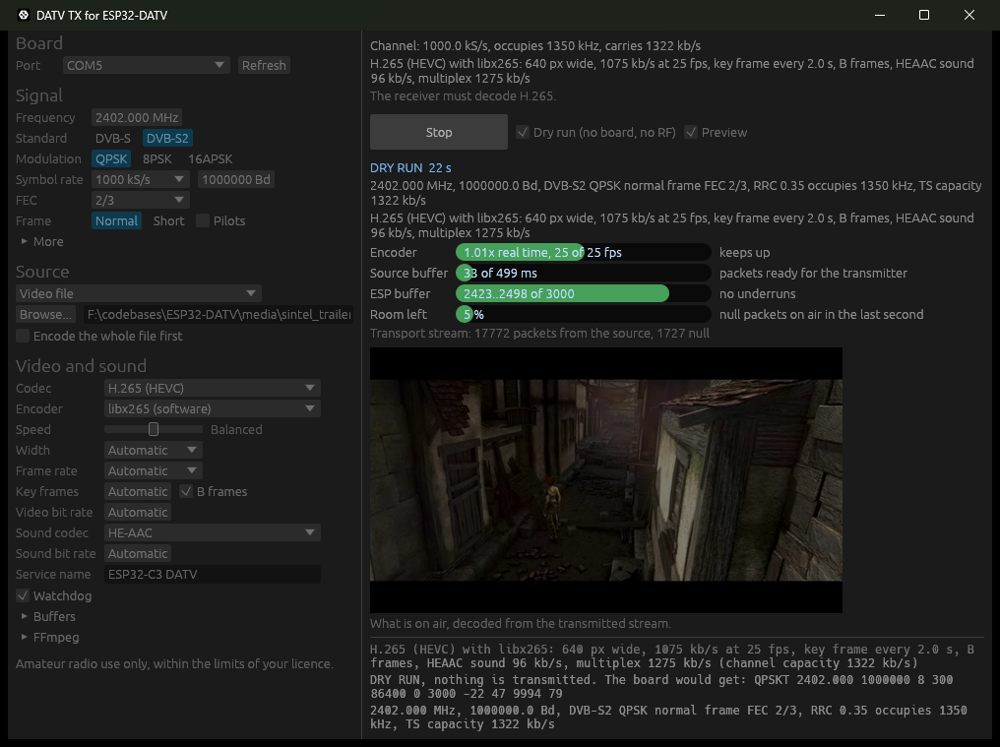
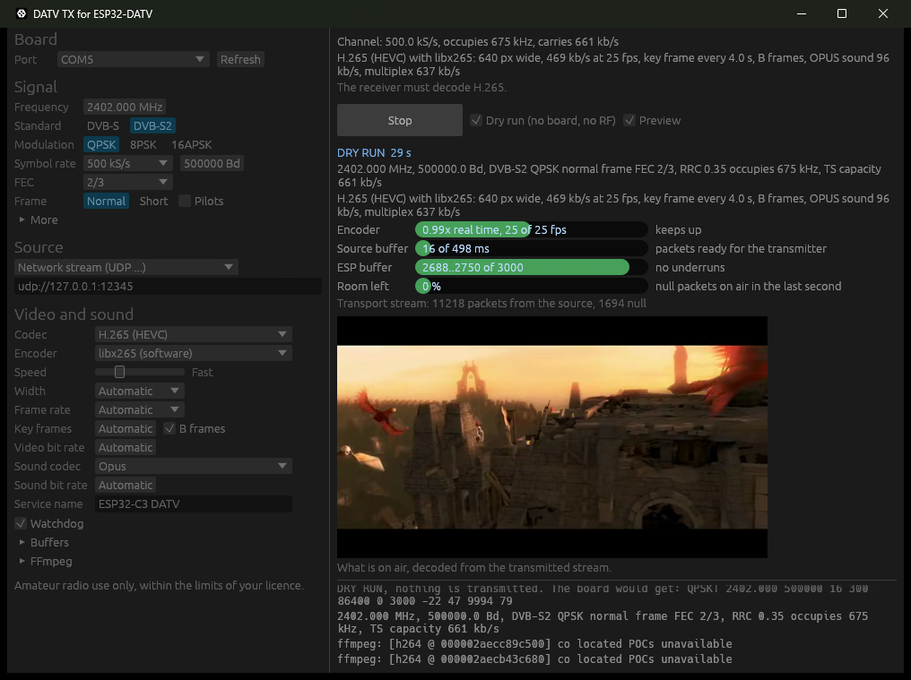
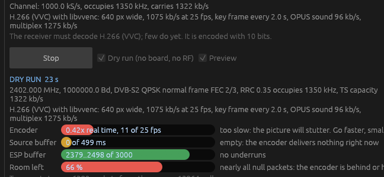
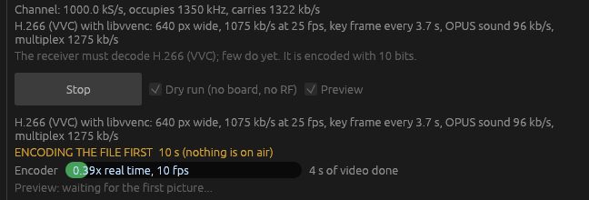
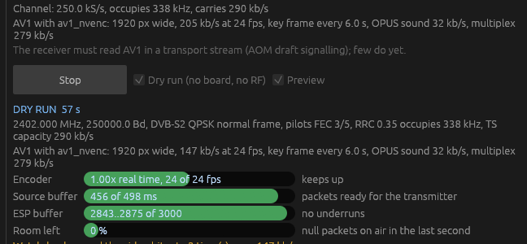

# ESP32-DATV-TX

A transmitter for the ESP32-DATV firmware with a choice of video codec: **H.264, H.265 (HEVC),
H.266 (VVC) or AV1**, and of sound codec: **MP2, MP3, AAC, HE-AAC, Opus, AC-3 or E-AC-3**. 

It is a Windows program in Rust for [ESP32-DATV](https://github.com/SP8ESA/ESP32-DATV) by SP8ESA,
the DVB-S / DVB-S2 transmitter that uses the ESP32-C3's own 2.4 GHz radio. It is a port of that
project's `host/tx_dvbs.py`: FFmpeg encodes picture and sound and makes the transport stream,
this program does the DVB-S / DVB-S2 coding and feeds the ESP32-C3 over USB. The board runs
the unchanged ESP32-DATV firmware.

Amateur radio use only, within the limits of your licence. The firmware transmits on
2300 to 2450 MHz only.



*A dry run (nothing transmitted): H.265 with HE-AAC sound in a 1 MS/s DVB-S2 channel. The
picture is decoded from the stream that would go on air.*

## What you need

- An ESP32-C3 with the ESP32-DATV firmware (flash it with that project's app, web flasher or ESP-IDF).
- [FFmpeg](https://ffmpeg.org/download.html) on `PATH` (or set its path under Video > FFmpeg).
  The codecs offered are the ones your FFmpeg has an encoder for:

  | Codec | Encoders used (the first one found is the default) |
  |---|---|
  | H.264 | libx264, h264_nvenc, h264_qsv, h264_amf, h264_mf |
  | H.265 (HEVC) | libx265, hevc_nvenc, hevc_qsv, hevc_amf, hevc_mf |
  | H.266 (VVC) | libvvenc |
  | AV1 | libsvtav1, av1_nvenc, av1_qsv, av1_amf, libaom-av1 |

## Build and run

```sh
cargo run --release                 # the window
powershell -ExecutionPolicy Bypass -File scripts\build-portable.ps1   # exe\datv-tx.exe, exe\datv-tx-cli.exe
```

Choose the port, the signal (frequency, DVB-S or DVB-S2, modulation, symbol rate, FEC), the
source (test pattern, video file, screen, camera, network stream, a ready `.ts`, null packets,
carrier) and
the codecs, then press **Transmit**. Picture size, frame rate and bit rates follow the channel
capacity as in `tx_dvbs.py`, or set them yourself:

- **Network stream**: an address FFmpeg reads, encoded again to fit the channel.
  `udp://127.0.0.1:1234` listens on port 1234 of this PC (send to it from OBS, VLC or another
  FFmpeg, for example `ffmpeg -re -i film.mp4 -f mpegts udp://127.0.0.1:1234`);
  `udp://@239.0.0.1:1234` joins a multicast group; `rtp://`, `srt://`, `rtsp://` and `http://`
  addresses work as far as your FFmpeg supports them. Null packets go out until the stream
  arrives.

  

- **Speed**: encoder effort from Fastest to Slowest. Slower gives a better picture for the
  same bit rate and needs more processor.
- **Width** up to 1920 px (1080p) and **frame rate** up to 60 fps. The channel still carries
  what it carries: 1080p in 1 Mb/s is soft, whatever the codec.
- **Key frames**: seconds between key frames (the GOP length), up to 30. On Automatic the
  program spaces them by video bit rate: 2 s from 600 kb/s, 4 s from 250 kb/s, 6 s from
  80 kb/s and 10 s below, because a key frame costs many times an ordinary frame and a
  narrow channel has few bits to spare. The price is the wait for the first picture after
  the receiver locks.
- **B frames** on or off for H.264 and H.265 (the AV1 and H.266 encoders decide themselves).
- **Sound codec** and bit rate. Opus runs at 48 kHz. AC-3 and E-AC-3 cannot go below
  32 kb/s and are made for several times that, so the window does not offer them on a
  channel under 200 kb/s: use Opus or AAC there. HE-AAC and HE-AAC v2 need an FFmpeg built
  with libfdk_aac (the usual Windows builds do not have it; FFmpeg's own AAC encoder makes
  AAC-LC only). `scripts/build-ffmpeg-fdk.sh` builds one in MSYS2 from the FFmpeg sources;
  such a build is "non-free": for your own use, not to be passed on. Put its folder under
  Video > FFmpeg > Program.
- **Encode the whole file first** (video file source): the file is encoded to a transport
  stream before anything is transmitted, then sent in a loop. The encoder need not keep up
  with real time, so the slow speeds and H.266 work at any picture size. The same file with
  the same settings is encoded only once (kept in `%TEMP%\datv-tx-cache`). At the point
  where the file starts again the receiver sees a jump in the clock and may glitch.
- **Watchdog** (on by default): some encoders cannot squeeze a picture as far as asked,
  NVENC with a large picture at a low bit rate for one, and make more than the channel
  carries. FFmpeg's multiplex then has no null packets left, its packets pile up and the
  stream runs later and later. When the watchdog sees both for 6 seconds it starts the
  encoder again with 15 % less video bit rate, as often as it takes; the picture breaks for
  a second or two each time and the stream's clock starts anew.
- **Buffers**: the encoder's rate buffer (VBV, default 0.5 s; larger evens out quality
  across busy and quiet scenes and adds delay) and the source buffer (encoded packets kept
  ready, default 0.5 s; smaller is less delay, larger rides out hiccups).
- **Preview**: a second FFmpeg decodes a copy of the stream that goes on air and the window
  shows its picture, so you see the result of the encoding, not the source.

While it runs, four bars show how it is doing:

| Bar | Meaning |
|---|---|
| Encoder | encoding speed against real time, from FFmpeg's progress reports: green keeps up, amber is a little slow, red is too slow and the picture will stutter |
| Source buffer | encoded packets waiting for the transmitter, in milliseconds |
| ESP buffer | symbols in the board's buffer; red if it has run dry (USB or the PC too slow) |
| Room left | null packets on air in the last second, FFmpeg's and the ones added here: near 100 % means the encoder delivers nothing; red when there are none and packets pile up (the watchdog's cue) |

An encoder that cannot keep up (here H.266 on Slow, encoding while transmitting) shows red;
the cure is a faster speed, a smaller picture, or encoding the file first:



With **Encode the whole file first** the same settings work, because nothing is transmitted
until the file is done:



The watchdog at work: NVENC asked for 1080p AV1 in 205 kb/s makes more than the channel
carries, and the video bit rate has been lowered twice until it fits:



**Dry run** runs everything into a simulated ESP: no board is opened and nothing is
transmitted. `datv-tx-cli` is the same engine on the command line:

```sh
datv-tx-cli --dry-run --seconds 10 --codec av1 --audio opus --baud 1000000 --fec 2/3 --ts-out on_air.ts
datv-tx-cli --port COM5 --freq 2402 --baud 333000 --dvbs2 --fec 2/3 --codec hevc --film film.mp4
datv-tx-cli --port COM5 --freq 2402 --baud 500000 --fec 2/3 --codec hevc --url udp://127.0.0.1:1234
datv-tx-cli --help
```

`datv-tx --defaults ...` starts the window from the built-in settings and leaves the saved
ones alone; with `--dry-run --start` it starts a dry run at once (the screenshots here were
made that way). The command line cannot start a real transmission in the window: that is
always a click on Transmit.

## Notes on the codecs

- The receiver must decode the codec you choose. H.264 works everywhere; H.265 is common;
  H.266 and AV1 need a recent software receiver.
- **H.266**: libvvenc takes 10 bit pictures only, so the stream is 10 bit. Only its fastest
  preset (Speed at Fastest or Fast) keeps up in real time at 640 px on a fast PC, and it
  looks ahead many frames, so at low frame rates the picture starts 10 to 15 seconds late.
- **AV1**: FFmpeg's MPEG-TS muxer writes AV1 without any signalling, so nothing can identify
  it. `src/av1ts.rs` rewrites the stream to the AOM draft "Carriage of AV1 in MPEG-2 TS"
  (25 March 2026): registration descriptor `AV01`, AV1 video descriptor, PES stream_id 0xBD,
  start codes with emulation prevention. The draft is not final and receivers that read it
  are rare; FFmpeg 9.0 itself does not demultiplex it yet.

## Tests

```sh
cargo test --release
```

The DVB-S and DVB-S2 coders give the same bytes as ESP32-DATV's `host/dvbs.py` and
`host/dvbs2.py` for every mode in that project's golden file (147 cases, copied to
`tests/fixtures/dvb_goldens.json`).

## Licence

PolyForm Noncommercial 1.0.0, the licence of ESP32-DATV (see `LICENSE`, with SP8ESA's
required notice): this program is a derived work. The DVB coding, the transmit loop and the
link protocol are ports of SP8ESA's Python code in `host/` of that project, and
`data/dvbs2_ldpc.json`, `data/cal.json` and `tests/fixtures/dvb_goldens.json` are copied from
it. The window, the FFmpeg pipeline with its codec choices, the AV1 carriage, the preview, the
watchdog and the rest of the Rust code are by CasualArclamp, under the same licence.
